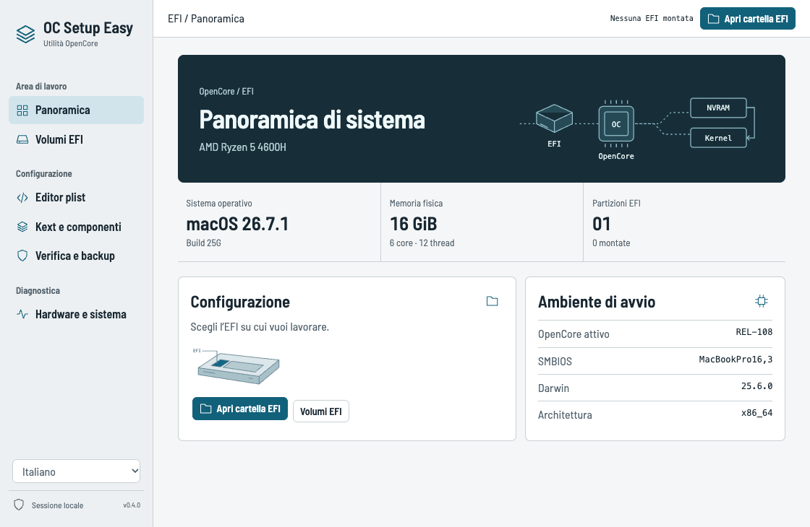

<div align="center">
  
  <h1>OC Setup Easy</h1>
  <p>Mount your EFI, compare installed kexts with <code>Kernel → Add</code>, and edit OpenCore on your Hackintosh.</p>
  <p><b>Rust</b> · Native macOS WebKit · Italian and English · Works offline</p>
  <p><a href="https://github.com/Skensy/OC-Setup-Easy/releases/latest"><b>Download for macOS (Universal)</b></a></p>
</div>



## Install

Download the disk image and drag the app to the Applications link, or download the Universal app ZIP for Intel and Apple Silicon from [GitHub Releases](https://github.com/Skensy/OC-Setup-Easy/releases/latest), unzip it, and drag **OC Setup Easy.app** into **Applications**. The published build is ad-hoc signed and has no Apple notarization. It targets macOS 11 or later and has been tested on an x86-64 AMD Hackintosh running macOS 26.7.1.

## Edit your first configuration

OC Setup Easy 0.4.0 supports English and Italian. Use the language selector at the bottom of the sidebar to switch without closing your draft. The app remembers your choice. The steps below use the Italian button labels.

1. Open **Volumi EFI** (EFI volumes). Identify your disk by its model, connection, and device identifier. Click **Monta** to mount it, then **Apri EFI** to open it. To work on a copy, use **Apri cartella EFI** and select the volume, the EFI folder, or the OC folder containing `config.plist`.
2. Open **Verifica e backup** (validation and backup) and create a ZIP before making changes. When OC sits inside EFI, the archive includes the entire EFI folder. Opening a standalone OC folder backs up that folder.
3. Open **Kext e componenti** (kexts and components). **Copia un kext** copies a bundle to disk. **Registra** adds a disabled entry to the draft plist. Review its plug-ins, enable the entries you need, and use the arrows to set their load order.
4. Open **Editor plist** to edit fields by section. Switch to **XML** to add or rename keys or edit whole arrays. **Salva plist** or **⌘S** validates and saves your draft. Close the configuration before unmounting its volume.

## What you can inspect

| View | Data and controls |
| --- | --- |
| Dashboard | CPU, core and thread counts, physical memory, macOS version and build, Darwin kernel, architecture, SMBIOS model, and the OpenCore version reported by NVRAM when available. |
| EFI volumes | Disk model, connection, partition size, mount point, and mount controls. macOS may ask for administrator authorization. |
| Plist editor | Standard and custom sections, dictionaries, arrays, and scalar values. XML and binary plists retain their original format when saved. |
| Kexts and components | On-disk bundles and plug-ins, versions, bundle IDs, declared dependencies, and load order among detected bundles. Compare and register ACPI tables, UEFI drivers, and tools. Removing a plist entry leaves its file on disk. |
| Validation and backups | Full ocvalidate output for the current draft, a copy of the previous plist on every save, and ZIP backups on demand. |
| Hardware and system | Boot arguments, loaded kexts, power profiles, and the reports available through system_profiler on your Mac, including graphics, audio, PCI, USB, networking, and NVMe. |

## Workspace tools in 0.2

- Use **Sort by dependencies** or **Sync EFI folders** to preview kext order, additions, and orphaned entries. Applying the preview changes the draft. When a cycle prevents sorting, the preview lists its members and preserves the current order.
- Use the Darwin version presets alongside MinKernel and MaxKernel, or enter a custom value in the plist editor.
- **Validate draft** shows schema output and hardware diagnostics side by side. Click a reported location to open the corresponding field or the closest identifiable section.
- **Show changes** compares the current on-disk plist with the draft by path and XML. **Export anonymized config** writes a separate copy with recognized serial, MLB, UUID and ROM fields masked, including their common NVRAM aliases. Custom keys and free-form text may still contain identifying data.
- In **PlatformInfo**, check the serial and MLB against the configured model or generate a new serial, MLB and UUID with macserial. The checks run locally.
- Read boot and panic logs from **Hardware and system**. The header shows mounted EFIs. With a configuration open on a mounted EFI, you can validate, save and unmount it. Ejecting an external device also unmounts its other volumes.
- **Check for OpenCore updates** contacts the official release service on demand and checks the archive’s SHA-256. Review the changed x86-64 boot files and existing standard drivers before applying. The app verifies a full EFI backup before replacing them. Validation selects the cached validator matching the SHA-256 of the opened OpenCore.efi.

## New in 0.3.0

- Undo and redo the last 50 draft edits in the plist editor. Use ⌘Z and ⇧⌘Z outside text fields. The window shows the open document and asks whether to save when you close a modified draft.
- Changes to EFI folders open a sync preview from the notification banner. Changes to the on-disk plist offer a reload. Hardware reports run in the background and stay in memory until refreshed.
- In **DeviceProperties → Add**, select a detected PCI device and convert properties between unsigned 32-bit little-endian integers, UTF-8, hex and Base64. Edit boot arguments as text or tags in **NVRAM** and on the dashboard.
- Validate the draft to find USB maps whose model differs from the configured SMBIOS. Review the affected personalities before applying the fix. The app backs up the bundle’s previous Info.plist.
- In **Validation and backups**, compare draft keys against a local Sample.plist or the sample from a downloaded OpenCore release. The comparison includes defaults for missing keys. Kext update checks contact GitHub only on request. Select the bundles to replace. Applying requires the complete EFI/OC directory, verifies the release SHA-256, creates a full EFI ZIP and checks the backed-up files.

## New in 0.4.0

- Use ⌘1 through ⌘6 to switch views, ⌘F to search plist paths, bundles or log lines, and ⌘E to mount or unmount the selected EFI volume.
- Expand the calculator beside ScanPolicy or csr-active-config to edit bit flags. SIP data uses four little-endian bytes.
- Compare live NVRAM with the saved plist or inspect update readiness for a target Darwin major version. A mismatch on a backup EFI may simply describe another computer.
- Inspect ACPI headers and import DSL sources with an installed iasl compiler. Compilation creates a new AML file and registers it in the draft. Save the draft to persist the registration.
- Release checks reuse GitHub ETags. Verified OpenCore archives supply matching offline validators under Application Support.

### Command line

The same executable runs as a CLI when passed a flag. Paths containing spaces can be quoted in the usual way.

```sh
oc="/Applications/OC Setup Easy.app/Contents/MacOS/oc-setup-easy"
"$oc" --check "/path/to/EFI/OC/config.plist"
"$oc" --sort-kexts "/path/to/EFI" --dry-run
"$oc" --sort-kexts "/path/to/EFI"
"$oc" --anonymize "/path/to/config.plist" "./anonymous.plist"
"$oc" --help
"$oc" --version
```

`--check` runs the matching cached or bundled ocvalidate and semantic diagnostics. Its exit status is 0 for success (including advisory host-model differences) and 1 for an error. Sorting uses the same backup and external-change checks as saving in the editor. Anonymizing requires a new output filename.

## Backups and recovery

Before saving, the app checks the on-disk plist against the version you opened. If another editor changed it, the save stops. Otherwise the app writes the new plist to a temporary file on the same volume, backs up the original, and replaces it. Importing a kext also checks for an existing bundle with the same name.

Use **Verifica e backup → Mostra backup** to open `~/Library/Application Support/OC Setup Easy/Backups`. To restore a plist, close the configuration, copy the backup into `EFI/OC` as `config.plist`, and reopen the folder. To recover individual EFI files, extract the ZIP to a separate folder first.

When the opened loader does not match a downloaded release, the bundled validator checks the **OpenCore 1.0.8** schema. Other versions can have different rules. Review missing files in the components view and test bootability on your hardware. [Official OpenCore 1.0.8 release](https://github.com/acidanthera/OpenCorePkg/releases/tag/1.0.8)

## Build from source

Install the Xcode Command Line Tools and stable Rust with Cargo on macOS. Run the following from the repository root.

```sh
./scripts/build-app.sh
open "dist/OC Setup Easy.app"
```

The script builds for the host Mac’s architecture. On the first build, it downloads the Rust dependencies and the official OpenCore 1.0.8 archive. It verifies the archive’s SHA-256 digest, extracts ocvalidate and macserial, and ad-hoc signs the app bundle.

To build a Universal app with both Intel and Apple Silicon executables, install both Rust targets and pass the packaging flag.

```sh
rustup target add x86_64-apple-darwin aarch64-apple-darwin
./scripts/build-app.sh --universal
```

To package the signed app as a ZIP and a Finder disk image, run `./scripts/package-dmg.sh` after either build. Packaging uses a private Python virtual environment for dmgbuild. The checksum file covers both artifacts. Pushing a version tag runs the Universal build and publishes those files after the checks pass.

### Source and tests

The Rust backend lives in `src/`. The AppKit window and WKWebView bridge are in `native/window.m`. The HTML, CSS, JavaScript, font, and graphics are in `ui/`.

```sh
cargo test --locked
cargo clippy --locked --all-targets -- -D warnings
```

The tests cover partition identifiers, opening a nested EFI folder, backups, conflicting edits, binary plists, importing kexts with plug-ins, and duplicate bundles.

OpenCore and ocvalidate are maintained by Acidanthera. The app includes the licenses for ocvalidate and the Barlow Semi Condensed typeface. [OpenCorePkg license](licenses/OpenCorePkg.txt) · [Barlow license](ui/FONT-LICENSE.txt)
